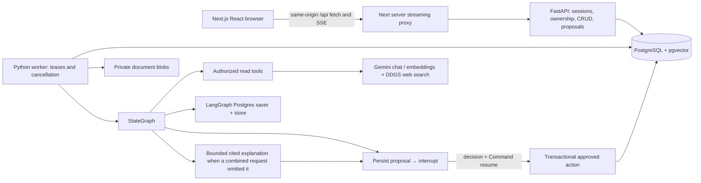

# Architecture

## Seven studied topics

| Topic | Implementation | Evidence |
|---|---|---|
| Persistence / thread IDs | `nexus/agent.py`, `graph_resources.py`; server-created conversation UUID is checked against authenticated owner before invocation | graph reopen test; e2e separate fixture processes |
| Tools | explicit model/tools loop, bounded counter; calculator AST, timezone clock, task/note reads, hybrid retrieval, real free web search | core tests, forced web outage test |
| RAG | `documents.py`: private uploads, parser, durable job, embeddings, exact pgvector + FTS reciprocal rank fusion | ingestion/retrieval/isolation tests, source drawer e2e |
| Streaming | durable run events; token chunks coalesced at 64 characters; nonbuffering Next route | SSE incremental unit test, graph event test, e2e projection rendering |
| HITL | persisted proposal → `interrupt()` → decision → `Command(resume=...)` → execute; no pre-interrupt mutation | graph edited/rejected/repeated/crash tests, e2e approval reload |
| Short-term memory | saver-owned graph state, reducers, complete tool turns, token context and summaries | thread isolation, context budget tests |
| Long-term memory | LangGraph Postgres store namespaces under authenticated user, project scope metadata, five relevant enabled memories | cross-thread retrieval and disable/delete tests |

Application rows do not replace checkpoints. Message projections hold the complete visible transcript;
model context can be summarized/pruned without removing those rows. Large blobs and events are outside graph state.
Runtime context contains the server-authorized user, run and worker lease, never identity from model input.

## Transactions and recovery

Only one queued/running/waiting run can exist per conversation (PostgreSQL partial unique index).
Workers claim with `FOR UPDATE SKIP LOCKED`, use 30-second run leases refreshed every two seconds,
and own a session advisory lock for the graph thread. Dead generation is explicitly failed with interrupted text;
it is not silently replayed against a provider. Waiting approvals have no worker lease and survive restarts.
Ingestion jobs have bounded attempts and processing leases; expired claims are reclaimed.
Document rows and worker identity are rechecked before inserting chunks, preventing resurrection after deletion.

Application event sequence allocation and partial transcript updates share short transactions.
No database transaction is held while awaiting a human or a model.
Proposal execution locks both proposal and run, validates current versions, applies an entire selected batch,
and persists its outcome in one transaction. A repeated graph execution returns that outcome.
Memory actions use the maintained synchronous PostgresStore on the ORM's psycopg connection so
the authoritative store write and proposal outcome share the same transaction. Normal memory retrieval is async.

Read calls and writes in one model turn are processed serially; all read results and approved/rejected write results
produce matching ToolMessages. Provider parallel tool requests are disabled; accidental multi-call turns are still supported.
Abandoned pairs are closed with an explicit canceled result before the next provider invocation.

For combined document-explanation/action requests, a separate read-only `ground_proposal` node
ensures a cited explanation exists before the review interrupt. It runs only when the model omitted
usable citations, uses bounded authorized excerpts, and updates the existing AI tool-call message
without splitting its pending tool/result pair. Citation normalization and bounded repair also apply
to messages that contain tool calls. Failed explanation runs invalidate their pending proposals.

## Retrieval

Chunks target 700 cl100k tokens with 100-token overlap. Embedding batches contain at most 32 chunks.
Database filters apply user, optional project, selected documents, ready state and embedding model before ranking.
Dense exact cosine and full-text rankings are fused using sum(1/(60+rank)); eight deduplicated chunks and
5,000 tokens bound ordinary retrieval. Coverage visits sections round-robin using a partitioned SQL row number, at most 80 chunks/10,000 tokens,
and explicitly returns covered/total counts and a completeness flag. Large documents need narrower follow-up scope.
No approximate vector index is necessary at initial scale; FTS uses a GIN expression index.

Official references checked during implementation:
[LangGraph persistence](https://docs.langchain.com/oss/python/langgraph/persistence),
[interrupts](https://docs.langchain.com/oss/python/langgraph/interrupts),
[OpenAI web search](https://developers.openai.com/api/docs/guides/tools-web-search),
[GPT-5 mini](https://developers.openai.com/api/docs/models/gpt-5-mini),
[embeddings](https://developers.openai.com/api/docs/guides/embeddings),
[pgvector](https://github.com/pgvector/pgvector), [Next App Router](https://nextjs.org/docs/app).
Installed exact dependency versions are pinned in `uv.lock` and `pnpm-lock.yaml`.

## Provider override (user request, 2026-10-24)

The user requires exclusively free tools/APIs. Gemini Developer API is now the default, with
Gemini 3.5 Flash-Lite for chat and free DDGS/DuckDuckGo for web search, Gemini Embedding 2 for vectors.
The maintained Google Gen AI SDK and LangChain Google integration back the same StateGraph.
`FREE_ONLY` rejects OpenAI and models outside the documented free-tier configuration; no fallback occurs.
Actual free quotas and billing enrollment are owned by Google: use a free project with billing disabled.
Search preserves grounding supports, actual URLs and the provider suggestions HTML when that optional backend is explicitly enabled, rendered in a
script-disabled sandbox iframe. Raw provider reasoning is never projected into UI/events.

References: [Google pricing](https://ai.google.dev/gemini-api/docs/pricing),
[Google embeddings](https://ai.google.dev/gemini-api/docs/embeddings),
[Google Search grounding](https://ai.google.dev/gemini-api/docs/google-search).

The live API rejected Gemini 2.5 Flash-Lite for a new account despite its catalog listing.
The explicitly selected replacement, 3.5 Flash-Lite, passed real tool calling. Its Google Search
API grounding is not listed as free, so the free-only default uses the open-source DDGS adapter
with DuckDuckGo. It returns real search snippets/URLs without fetching arbitrary result URLs.
Google grounding and OpenAI adapters are never automatic fallbacks.

Deletion uses durable project/conversation markers before canceling runs and deleting checkpoints.
New associations and new runs reject marked resources. A claimed worker revalidates its run after
acquiring the advisory lock, before writing any checkpoint. This closes the claim/delete/start race.
Markers and run cancellation use separate short transactions to avoid project/run lock-order inversion;
repeating a deletion can finish an interrupted cleanup.
